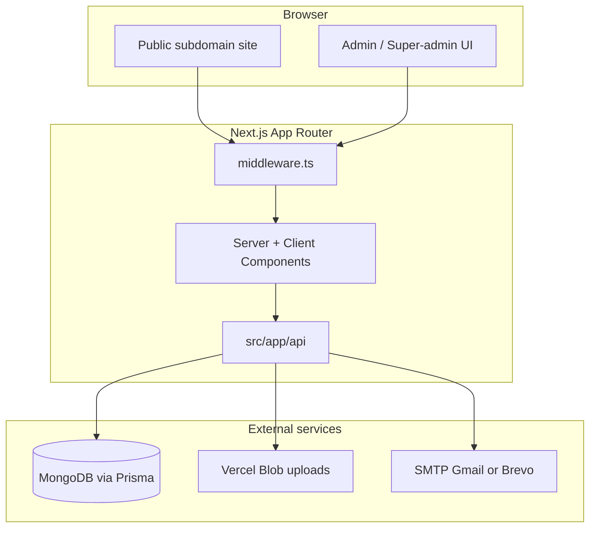

# Gram Panchayat Website — Project Documentation

This document describes the **gram-panchayat-website** codebase: purpose, architecture, major modules, APIs, and operational workflows. It is intended for developers and AI assistants onboarding to the repository.

---

## Table of contents

1. [Project overview](#1-project-overview)
2. [Architecture and system design](#2-architecture-and-system-design)
3. [Key features and modules](#3-key-features-and-modules)
4. [Tech stack](#4-tech-stack)
5. [Repository layout](#5-repository-layout)
6. [Data model (high level)](#6-data-model-high-level)
7. [Authentication, roles, and tenancy](#7-authentication-roles-and-tenancy)
8. [API structure](#8-api-structure)
9. [Important workflows and logic](#9-important-workflows-and-logic)
10. [Setup and installation](#10-setup-and-installation)
11. [Environment variables](#11-environment-variables)
12. [Related documentation in the repo](#12-related-documentation-in-the-repo)

---

## 1. Project overview

**Purpose:** A multi-tenant web platform for **Gram Panchayat** (village council) public websites and administration. Each panchayat is represented by a **subdomain** (e.g. `villagename.example.com`) with its own content, branding, and admin users. Content is bilingual where modeled: **Marathi** and **English**.

**Who uses it:**

- **Citizens** — Browse public pages (schemes, announcements, facilities, feedback, dashboards, etc.).
- **Panchayat admins** — Manage content for their subdomain via `/admin` (after login).
- **Super admins** — Provision subdomains, manage campaign evaluation forms, view activity logs, and manage platform-wide users via `/super-admin`.

The root `README.md` is user-facing (Marathi); this file focuses on **technical structure**.

---

## 2. Architecture and system design

### 2.1 High-level diagram



### 2.2 Application type

- **Monolithic Next.js app** (frontend + backend in one codebase).
- **Rendering:** App Router with React Server Components for many public pages; client components for interactive admin and forms.
- **API:** Next.js Route Handlers under `src/app/api/**/route.ts` (REST-style JSON endpoints).

### 2.3 Multi-tenancy model

- **Tenant key:** `Subdomain` record in MongoDB (`subdomain` string is unique).
- **Data isolation:** Most content models include optional `subdomainId` pointing at `Subdomain`.
- **Request resolution:**
  - **Middleware** (`src/middleware.ts`) detects hostname subdomain, rewrites public paths to `/subdomain/[subdomain]/...`, and sets `x-subdomain` on API requests from subdomain hosts.
  - **API helpers** (`src/lib/subdomain.ts`) read `x-subdomain` or parse `Host` to resolve `subdomainId` via `validateSubdomain()` / `getSubdomainId()`.

Reserved host labels used in code: `www`, `mahagp` (treated as “main” / no tenant rewrite in several paths).

### 2.4 Security layers

- **JWT sessions** via NextAuth (credentials provider, bcrypt passwords).
- **Route protection:** Middleware enforces login for `/super-admin/*` (super roles) and `/admin/*` plus `/subdomain/*/admin/*` patterns.
- **Subdomain admin:** Token carries `subdomainId`; middleware performs basic checks; layouts/API handlers enforce ownership where implemented.

---

## 3. Key features and modules

### 3.1 Public site (per subdomain)

Routes live under `src/app/subdomain/[subdomain]/`. Representative pages:

| Route segment | Typical purpose |
|---------------|-----------------|
| `/` | Home: hero, about, announcements, history, cultural heritage, weather, pragati meter, news, daily message, leaders, QR tax, water/sanitation highlights, etc. |
| `about` | Village profile |
| `history` | History cards + timeline |
| `announcements` | Announcements & related notice content |
| `programs` | Programs / events |
| `gallery` | Media gallery |
| `gov-programs` | Government schemes |
| `departments` | Departments |
| `amenities` | Facilities / amenities (incl. GIS-style facility data where used) |
| `jama-kharch` | Income & expense (transparency) |
| `contact` | Contact |
| `gr` | Government resolutions (GR) |
| `projects` | Projects / initiatives |
| `jobs` | Employment, tenders, training, FPO, talent |
| `education` | Education & youth content |
| `environment` | Environment & sustainability |
| `dashboard` | “My village, my progress” style dashboard |
| `feedback` | Citizen feedback / grievances |
| `citizen-services` | Citizen services hub |
| `sitemap` | Content index |

Exact sections per page depend on implemented components and fetched data.

### 3.2 Admin panel (panchayat)

Under `src/app/admin/`: dashboards and CRUD-style screens for village info, announcements, schemes, facilities, infrastructure (water/sanitation, roads/lighting, education/health), projects, GRs, employment/education/environment bundles, campaign form, feedback, metrics, gallery, etc. Navigation is centralized in components such as `src/components/admin/admin-sidebar.tsx`.

### 3.3 Super admin

- **UI:** `src/app/super-admin/` (layout-protected).
- **Login:** `/super-admin-login`.
- **API:** `src/app/api/super-admin/*` — subdomains CRUD, users, campaign form definitions (sections/items), activity logs (+ export).

### 3.4 Campaign form system

Structured evaluation forms (`CampaignForm`, `FormSection`, `FormItem`, `FormSubmission`, `FormItemValue`) support scored submissions per subdomain. Admin-facing pages under `/admin/campaign-form/*`; APIs under `/api/campaign-form/*` and super-admin routes for schema editing.

### 3.5 Supporting scripts (repo root)

Node scripts such as `import-villages-data.js`, `create-super-admin-viewer.js`, and email test utilities support data import and operations outside the main app (run with appropriate env and review before production use).

---

## 4. Tech stack

| Layer | Technology |
|-------|------------|
| Framework | **Next.js 15** (App Router), **React 18** |
| Language | **TypeScript** |
| Database | **MongoDB** via **Prisma** ORM |
| Auth | **NextAuth.js v4** (JWT, Credentials provider) |
| Styling | **Tailwind CSS**, **Radix UI** primitives, **class-variance-authority**, **tailwind-merge** |
| UI / UX | **Lucide** icons, **Framer Motion**, **Recharts**, **Sonner** toasts |
| File storage | **Vercel Blob** (`@vercel/blob`) for uploads |
| Email | **Nodemailer** (Gmail or generic SMTP / Brevo-style) |
| Other | **bcryptjs**, **ExcelJS** (exports), **@dnd-kit** (drag-and-drop in admin) |

---

## 5. Repository layout

```
gram-panchayat-website/
├── prisma/
│   ├── schema.prisma      # MongoDB models (large multi-tenant schema)
│   └── seed.js            # DB seed (referenced from package.json)
├── public/                # Static assets
├── src/
│   ├── app/               # App Router: layouts, pages, API routes
│   │   ├── admin/         # Panchayat admin pages
│   │   ├── super-admin/   # Platform admin pages
│   │   ├── subdomain/[subdomain]/  # Tenant public pages
│   │   └── api/           # REST handlers
│   ├── components/        # UI: admin/*, sections/*, layout/*, ui/*
│   ├── lib/               # prisma, auth, subdomain, upload, email, logging helpers
│   ├── types/             # Shared TS types
│   └── middleware.ts      # Subdomain rewrite + auth gates
├── package.json
├── README.md
├── README-IMPLEMENTATION.md   # Guideline / gap analysis notes
└── DYNAMIC_SECTIONS_REFERENCE.md # Homepage section ↔ model ↔ admin mapping
```

---

## 6. Data model (high level)

Prisma schema: `prisma/schema.prisma`. MongoDB collections map to models via `@@map("...")`.

**Core tenancy**

- `Subdomain` — tenant record (slug, village names, contact, district/taluka/village linkage fields, admin credentials for provisioning, `status`, `isActive`).
- `AdminUser` — logins; `role` and optional `subdomainId`.

**Content & pages (examples)**

- Home / branding: `VillageInfo`, `HomepageSettings`, `HeroImage`, `FooterContent`, `Leader`, `ProgressMetric`, `NewsItem`, `DailyMessage`, `QRCodeSettings`, etc.
- Governance & transparency: `Announcement`, `GovernmentScheme`, `GovernmentResolution`, `IncomeExpense`, `Department`, `Project`, `Complaint`, etc.
- Sector hubs: education (`School`, `ScholarshipScheme`, …), employment (`JobOpportunity`, `Tender`, …), environment (multiple green/waste/water models), infrastructure snapshots (`WaterSanitationSnapshot`, `RoadsLightingSnapshot`, `EducationHealthSnapshot`) and related facility rows.
- Dashboards: `DashboardMetric`, `DashboardOverview`, `DashboardKpiMetric`, `ImpactDashboardMetric`, ward comparison, achievements, activities, etc.
- Campaign forms: `CampaignForm`, `FormSection`, `FormItem`, `FormSubmission`, `FormItemValue`.
- Geography reference: `District`, `SubDistrict`, `Village` (for registration / hierarchy).
- Auditing: `ActivityLog` (who changed what, optional geo filters).

Many fields exist in **Marathi + English** pairs (`title` / `titleEn`, etc.).

---

## 7. Authentication, roles, and tenancy

### 7.1 NextAuth configuration

- File: `src/lib/auth.ts`
- **Provider:** Credentials (username or email + password).
- **Passwords:** Stored hashed; verified with `bcryptjs`.
- **Session:** JWT; token includes `id`, `role`, `subdomainId`, `subdomain` string.
- **Custom pages:** `signIn: '/admin/login'`.

### 7.2 Roles (from schema / usage)

| Role | Typical access |
|------|----------------|
| `super_admin` | Full super-admin panel; destructive actions where enforced |
| `super_admin_viewer` | Super-admin UI with view-only constraints where `canDelete` / similar checks apply |
| `admin` | Panchayat admin for assigned `subdomainId` |
| `editor` | Content editing role (as used in admin APIs/UI) |

Helpers: `src/lib/auth-helpers.ts` (`isSuperAdmin`, `canDelete`, `getUserRole`).

### 7.3 Subdomain detection differences

- `auth.ts` `getSubdomainFromHostname` uses **3-part host** (`sub.subdomain.example`) for subdomain extraction.
- `middleware.ts` and `lib/subdomain.ts` also support **2-part local dev** hosts (`village.localhost:3000` style).

When testing locally, align hostname patterns with these rules.

---

## 8. API structure

All handlers are under `/api/...` (relative to the site origin). Below is a **grouped catalogue** of route files; HTTP methods and body shapes follow per-file conventions (mostly JSON REST).

### 8.1 Auth & account

| Path | Role |
|------|------|
| `/api/auth/[...nextauth]` | NextAuth |
| `/api/auth/forgot-password` | Password reset request |
| `/api/auth/reset-password` | Reset with token |
| `/api/auth/change-password` | Authenticated password change |

### 8.2 Tenancy & registration

| Path | Role |
|------|------|
| `/api/subdomain/register` | New subdomain registration flow |
| `/api/subdomain/validate` | Validate subdomain availability / state |
| `/api/validate-subdomain` | Subdomain validation helper |
| `/api/villages/districts`, `/subdistricts`, `/villages/villages` | Geographic cascades for forms |

### 8.3 Super admin

| Path | Role |
|------|------|
| `/api/super-admin/subdomains`, `/subdomains/[id]` | Tenant CRUD |
| `/api/super-admin/users`, `/users/[id]` | Platform user management |
| `/api/super-admin/create` | Creation helper (e.g. bootstrap) |
| `/api/super-admin/campaign-forms` (+ nested `sections`, `items`) | Form definition CRUD |
| `/api/super-admin/activity-logs`, `/activity-logs/export` | Audit log |

### 8.4 Campaign form (subdomain runtime)

| Path | Role |
|------|------|
| `/api/campaign-form/basic-info` | Basic submission metadata |
| `/api/campaign-form/submit`, `/submission` | Submit / fetch submission |
| `/api/campaign-form/calculate` | Scoring / totals |
| `/api/campaign-form/export-excel` | Excel export |

### 8.5 Content & CRUD (tenant-scoped via `validateSubdomain`)

Representative resources (often `GET` public/list, `POST`/`PUT`/`DELETE` admin — verify each route):  
`announcements`, `village-info`, `homepage-settings`, `hero-images`, `footer-content`, `history-cards`, `timeline-items`, `cultural-heritage`, `programs`, `gallery`, `departments`, `facilities`, `contacts`, `team-members`, `office-details`, `map-settings`, `income-expense`, `government-schemes`, `government-resolutions`, `projects`, `leaders`, `news-items`, `daily-messages`, `progress-metrics`, `qr-code-settings`, `dashboard-metrics`, `social-feeds` (if exposed), `sankalp-items`, `before-after-gallery`, `impact-dashboard-metrics`, `roles`, `emergency-contacts`, `meeting-notifications`, `circulars`, `important-deadlines`, `downloadable-files`, `calendar-events`, `beneficiary-stories`, `ward-coverage`, `application-process`, `education-health`, `water-sanitation`, `roads-lighting`, `infrastructure-page-settings`, `infrastructure-facilities`, `smart-village-metrics`, `service-status-items`, and nested `[id]` routes where present.

**Dashboard slices:** `/api/dashboard/overview`, `kpis`, `progress`, `wards`, `achievements`, `activities`, `content-stats`.

**Sector bundles:** `/api/job-opportunities`, `tenders`, `training-programs`, `fpo-groups`, `village-talent`, `employment-contact`, `schools`, `scholarship-schemes`, `student-achievements`, `career-guidance`, `nss-activities`, `youth-success-stories`, `education-contact`, `environmental-metrics`, `green-initiatives`, `waste-management`, `water-conservation`, `adopted-trees`, `environment-events`, `environment-contact`, etc.

### 8.6 Citizen & utilities

| Path | Role |
|------|------|
| `/api/complaints`, `/complaints/[id]`, `/complaints/track` | Grievances + public tracking code |
| `/api/search` | Unified search |
| `/api/sitemap` | Machine or structured sitemap data |
| `/api/weather` | Weather proxy/widget data |
| `/api/upload` | File upload (images via `uploadImage`) |
| `/api/map-settings` | Map embed settings |

### 8.7 Legacy / specialized admin paths

Some resources use `/api/admin/...` (e.g. `announcements`, `village-info`, `footer-content`) alongside top-level resource routes—check handlers for the canonical pattern for new work.

---

## 9. Important workflows and logic

### 9.1 Public request on a tenant host

1. Browser requests `https://{tenant}.domain.com/about`.
2. **Middleware** matches non-api paths, extracts `{tenant}`, skips rewrite for reserved labels, rewrites to `/subdomain/{tenant}/about`.
3. Page server component loads data filtered by `subdomain` slug (Prisma `findUnique` on `Subdomain` or by `subdomainId`).

### 9.2 API call from a tenant host

1. Middleware adds `x-subdomain: {tenant}` for `/api/*` on tenant hosts.
2. Handler calls `validateSubdomain(request)` to get `subdomainId`.
3. Queries use `where: { subdomainId }` (and `isActive` where applicable).

### 9.3 Admin content update

1. Admin logs in via NextAuth; JWT contains `subdomainId`.
2. Client calls API (often with session cookie).
3. Handler must ensure mutations apply only to records owned by that `subdomainId` (pattern varies per route—follow existing handlers when extending).

### 9.4 Super admin provisions a new panchayat

Typically: create `Subdomain` + credentials, optional seed content, email notification via `src/lib/email.ts` when SMTP is configured.

### 9.5 File uploads

`POST /api/upload` accepts `multipart/form-data` with `file`.  
`src/lib/upload.ts` uploads to **Vercel Blob** using `BLOB_READ_WRITE_TOKEN`; validates images (type, size) for `uploadImage`.

### 9.6 Activity logging

Mutations in admin/super-admin flows can write `ActivityLog` entries (see `src/lib/activity-logger.ts`, `activity-log-helper.ts`) for audit trails and exports.

---

## 10. Setup and installation

**Prerequisites**

- Node.js **18+** (20 LTS recommended)
- MongoDB connection string (Atlas or self-hosted)
- Optional: Vercel Blob token, SMTP or Gmail for mail

**Steps**

```bash
cd gram-panchayat-website
npm install
```

Create environment variables (see [§11](#11-environment-variables)). Then:

```bash
npx prisma generate
npm run db:push          # or your preferred Prisma workflow for MongoDB
npm run db:seed          # optional: seed demo data
npm run dev              # http://localhost:3000
```

**Quality commands**

```bash
npm run lint
npm run type-check
npm run build
```

**Local subdomain testing**

Use a hostname that matches middleware rules (e.g. map `something.localhost` in hosts file or use tooling that preserves subdomain), or use path-based `/subdomain/[subdomain]` directly where applicable.

---

## 11. Environment variables

| Variable | Purpose |
|----------|---------|
| `DATABASE_URL` | MongoDB connection string for Prisma |
| `NEXTAUTH_SECRET` | JWT encryption secret |
| `NEXTAUTH_URL` | Canonical site URL (emails, absolute links) |
| `BLOB_READ_WRITE_TOKEN` | Vercel Blob uploads |
| **Email (choose one setup)** | |
| `SMTP_HOST`, `SMTP_USER`, `SMTP_PASS`, `SMTP_PORT`, `SMTP_FROM_EMAIL` | Brevo / generic SMTP |
| `GMAIL_USER`, `GMAIL_PASS` | Gmail SMTP |

Exact requirements for optional features are enforced in code paths (e.g. `src/lib/email.ts`).

---

## 12. Related documentation in the repo

| File | Contents |
|------|----------|
| `README.md` | Marathi overview, quick start, high-level structure |
| `README-IMPLEMENTATION.md` | Government guideline mapping, gaps, planned features |
| `DYNAMIC_SECTIONS_REFERENCE.md` | Homepage sections ↔ Prisma models ↔ admin UI mapping |

---

*Generated from repository analysis. For behavioral details of a specific endpoint or page, open the corresponding `route.ts` or `page.tsx` under `src/app`.*
